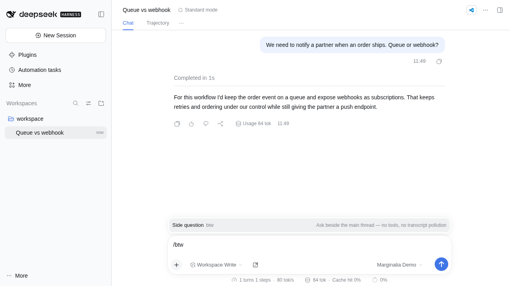
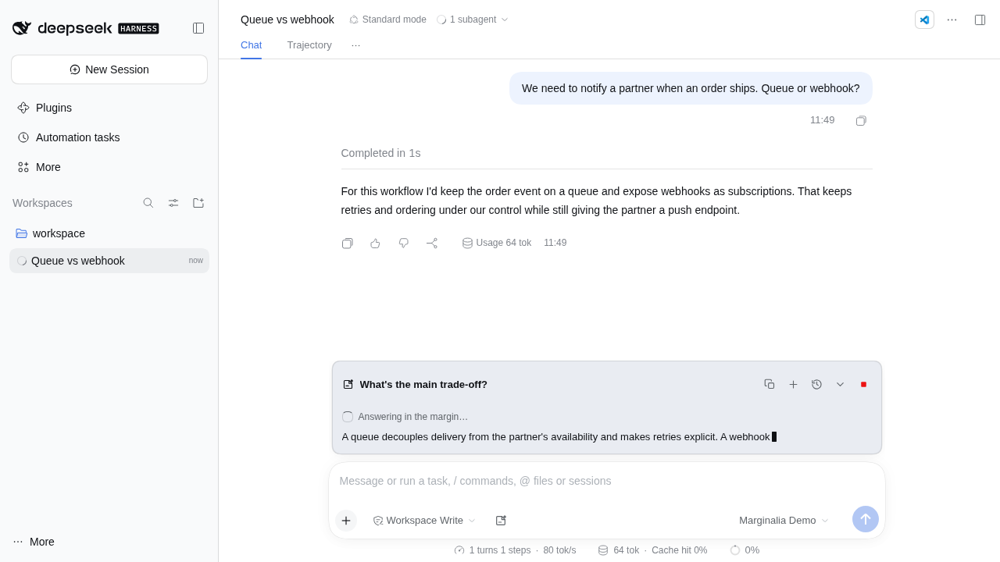
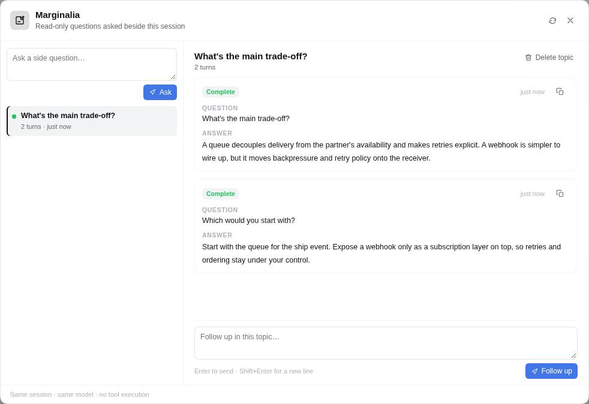
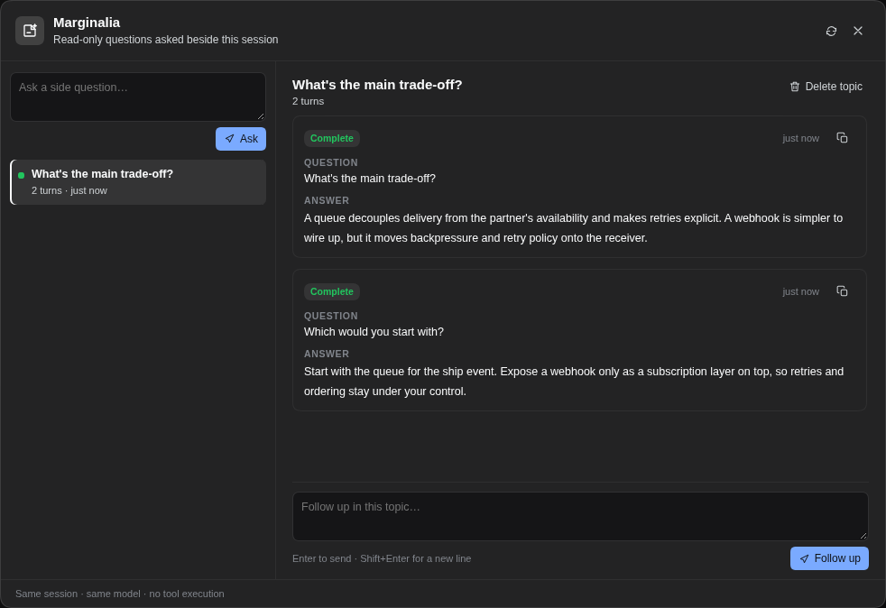

<p align="right">
  <a href="README.zh-CN.md"></a>
</p>

# dsh-btw-marginalia

> Read-only side questions for DeepSeek Harness. Ask in the margin, keep the main thread clean.

`marginalia` (noun): notes written in the margin of a page. That is what `/btw` is in
[oh-my-pi](https://github.com/can1357/oh-my-pi): a note taken beside the main conversation,
without changing it.

This is a DSH Host + Web Client bundle that implements the practical form of that contract:

- **Same conversation** — the side turn forks the current session, so it sees the same system
  prompt, the same tool catalog, and the same completed history.
- **Read-only, enforced** — the inherited tools remain in the request to preserve the prompt
  prefix, but an execution-time guard rejects every tool call. This is not a prompt request.
- **Visible in-flight context** — while the main turn is running, the side prompt gets a compact,
  capped snapshot of the current user request, recent tool calls/results, and the live assistant
  partial. This is what makes first-turn `/btw` useful even before `turn/end`.
- **Topics and history** — every question is persisted with its status and answer; follow-ups
  replay the topic and see the parent conversation as it is *now*.
- **Streaming and cancellation** — the Web Client retains the child session, renders its partial
  text, and preserves what was generated when you stop it.
- **No fabricated branch** — DSH has no public "insert an assistant message / create a branch"
  API. Marginalia does not pretend; it offers **insert into composer** as the safe replacement.

## Screenshots

<p align="center">
  
  
</p>
<p align="center"><sub>The real <code>/btw</code> slash entry · streaming in the margin, with Stop and insert actions</sub></p>

<p align="center">
  
  
</p>
<p align="center"><sub>Topic history with follow-up · light and dark DSH themes</sub></p>

Screenshots are produced by the Playwright screenshot spec (`npm run screenshots`) against an
isolated Host and a deterministic demo model, not by hand-editing the UI.

## Requirements

- DSH `>= 0.2.1-rc.1 < 0.3.0-0` (tested against `0.2.1-rc.2`)
- Node `>= 22`
- Works on a plain-HTTP LAN Web GUI: `crypto.randomUUID` is restricted to secure contexts, so the plugin uses `getRandomValues` (or a non-cryptographic identifier fallback) when needed.
- A composed `fork` subagent provider and `storage-domain` for durable history
  (both are part of the standard Web profile; the plugin falls back to process memory if the
  storage domain is absent)
- For the browser suite: `dsh` on `PATH` (or `DSH_BIN`), `pnpm`, and Playwright Chromium + Firefox

## Install

### Into a DSH profile

```bash
dsh plugin --profile web add github:LTP414/dsh-btw-marginalia
```

A git-hosted install builds the bundle once; DSH asks you to approve that build script
(`allowBuilds`) before it runs. The published package installs prebuilt and skips that step:

```bash
dsh plugin --profile web add dsh-btw-marginalia
```

### From this checkout

```bash
npm install
npm run check          # typecheck + 58 unit tests + build + smoke
npm run test:e2e       # 18 browser tests across Chromium/Firefox + dark projects
```

Then install the workspace directory as a bundle through the Harness plugin manager, or add it to
a bundle composition:

```yaml
- insert:
    - id: dsh-marginalia
      name: dsh-btw-marginalia
```

The built package is self-contained: the Host half bundles its only runtime dependency (`zod`) and
the Client half bundles its Markdown renderer. React and the Harness packages are supplied by the
Host's module table.

## Use

| Action | How |
| --- | --- |
| Ask beside the current session | `/btw 刚才为什么选方案 B？` |
| Open topic history | `/btw` with no argument, or the Marginalia button at the left of the composer |
| Follow up in the same topic | The send icon on a finished bubble, or the follow-up box in history |
| Stop a running answer | The stop button on the bubble; the partial answer is kept |
| Copy / insert / retry / delete | Buttons on a bubble, a history turn, or the composer |
| Close the history panel | `Esc`, the close button, or click the backdrop |

`/btw` accepts text only. Images and files stay in the composer and the submission is refused, so
the draft is not silently lost.

## How it works

```
/btw question
  → Client input trigger claims the line
  → Host btw-ask (authenticated command RPC, lifecycle logging suppressed)
      reserve child id → guard the id → fork the parent
      append one user-role <btw> prompt
      persist a running turn
  → Client retains the child session and follows its Chat target
  → Host stream capture keeps partial text; cancellation persists it
  → Host persists complete/cancelled/error; child is archived best-effort
```

The public `/btw` command is contributed by an `inputTriggers` slash source, not by patching the
official command UI. Bubbles use `conversation.input.overlay`; history uses `shell.overlay`; the
toolbar button uses `conversation.input.left`. The host-side compatibility shims hide the internal
transport commands from the slash directory and drop their `command/run`/`command/done` lifecycle
pair, so the main transcript and session log stay clean.

See [`docs/architecture.md`](docs/architecture.md) for the full design and
[`docs/verification.md`](docs/verification.md) for what has and has not been exercised.

## Data

- Domain: `marginalia`, table `topics`, key `${parentSessionId}:${topicId}`.
- A turn stores only visible question/answer text and status; reasoning and tool payloads are not
  persisted.
- On startup, `running` turns become `interrupted`; they are never retried automatically.
- Limits: 8k question, 8k quote, 64k replayed topic history, 256 KiB answer, 50 topics/session,
  200 turns/topic, 4 active side questions process-wide, 10 minute watchdog.

The internal commands are `btw-ask`, `btw-list`, `btw-get`, `btw-cancel`, `btw-delete`. They are
hidden from the slash menu and quiet in the session log, but still resolve for the authenticated
RPC. This reuses the existing authenticated carrier without opening an unauthenticated HTTP route;
a native Remote namespace remains the better long-term transport. The quieting shim depends on
`CommandRuntime.appendLifecycle`; if a future DSH removes it, the plugin logs a warning and falls
back to visible command lifecycle events.

## Security properties

- No HTTP routes. All reads/writes go through the authenticated `commands.execute` RPC.
- The side child can never execute a tool, including `send_message`.
- No raw HTML, remote images, or sanitized Markdown extensions are rendered in answers.
- Host errors are reduced to one bounded, control-character-free line.
- The plugin refuses to start from a subagent view; side questions are a main-session feature.
- Child sessions inherit the parent's sandbox/permission model; the guard only removes tool
  execution, it does not widen permissions.

## Browser support

The Web UI is exercised in Chromium and Firefox. The dark-theme history regression pins the send
label contrast and the scroll/pinned-follow-up layout; `Firefox + DSH dark` was the original failure
combination.

## Honest limitations

- **Not truly ephemeral.** A local fork creates a durable child session. Marginalia archives it
  after completion when the workspace registry is available; it cannot make the Host forget it.
  History itself is stored in a sidecar domain.
- **No branch.** DSH exposes no public assistant-message injection/branch API. The `b` behavior of
  oh-my-pi is intentionally not imitated.
- **History replay is text, not role-level messages.** The child receives one user prompt with a
  `<btw-history>` section. Role-level replay would require a direct LLM call and would lose the
  fork's system/tools/cache inheritance.
- **Prompt cache is preserved, not guaranteed.** Marginalia never changes system/tools/messages;
  the completed-turn prefix can be reused, but the current open-turn snapshot is new text, so it is
  necessarily outside that cache. Whether a provider reuses the prefix remains its decision.
- **Open-turn context is best-effort and snapshot-based.** Fork cannot seed an unbalanced turn, so
  Marginalia injects the current task/tool/partial snapshot itself. It is capped, taken when you
  ask, and may be stale if the main turn advances while the side answer is generated.
- **Archive is best-effort.** A failed archive is logged; the side history is still correct.
- **Transport is still command RPC.** The lifecycle shim removes transcript/log pollution, but the
  internal commands remain directly callable by an authorized RPC client. A generated Remote
  namespace would be cleaner; it is not implemented yet.
- **Subagent view is not in the browser suite.** Unit tests cover the refusal and hidden toolbar;
  navigating into a live delegated child in the GUI is not automated.
- **Real-provider acceptance is gated.** `real.nightly.spec.ts` is skipped unless
  `DSH_E2E_REAL=1` and `DEEPSEEK_API_KEY` are set.

## End-to-end verification

The browser suite starts a **separate** `DSH_HOME` and custom profile per worker, authenticates
through the real launch-token exchange, seeds a workspace, and runs a deterministic fake LLM that
streams tokens, aborts, and forces a tool call. It binds a non-loopback HTTP address by default so
the insecure-context UUID path is exercised for real. Chromium and Firefox run the core eight
specs; both browsers also run a dark-theme history regression against the real `ui-theme` setting.

Covered specs: slash menu claim, token-level growth, Stop with partial history, follow-up topic,
reload persistence, read-only tool denial with an untouched file, insert-to-composer, a plain-HTTP
origin with `crypto.randomUUID === undefined`, first-turn context while the main turn is running,
and dark-theme history button/layout behavior.

See [`docs/e2e.md`](docs/e2e.md). Real-preset acceptance stays out of the deterministic suite:

```bash
DSH_E2E_REAL=1 DEEPSEEK_API_KEY=... npm run test:e2e:real
```

## Development

```bash
npm run typecheck
npm test
npm run build
npm run test:coverage
npm run test:e2e
```

Layout:

```
src/index.ts            Host entry and wiring
src/shared.ts           protocol, limits, prompt, sanitization
src/host/               engine, storage, guard, stream capture, commands
src/client/             trigger source, store, bubble, history, styles
tests/                  pure unit and wiring tests
e2e/                    isolated Host, fake LLM, Playwright specs
scripts/                build and built-artifact smoke
docs/                   design research, architecture, verification, e2e
```

## License

Apache-2.0. See [`LICENSE`](LICENSE), [`NOTICE`](NOTICE), and
[`THIRD_PARTY_NOTICES.md`](THIRD_PARTY_NOTICES.md). The design is based on the three-way analysis in
[`docs/three-way-analysis.md`](docs/three-way-analysis.md).
